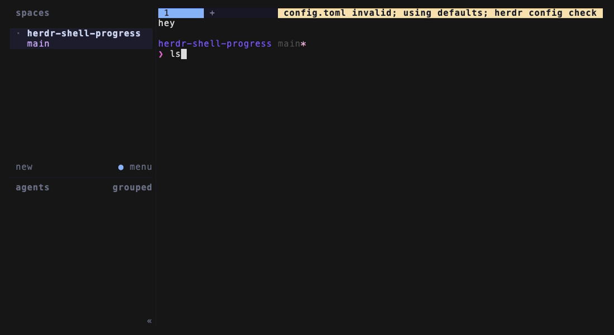
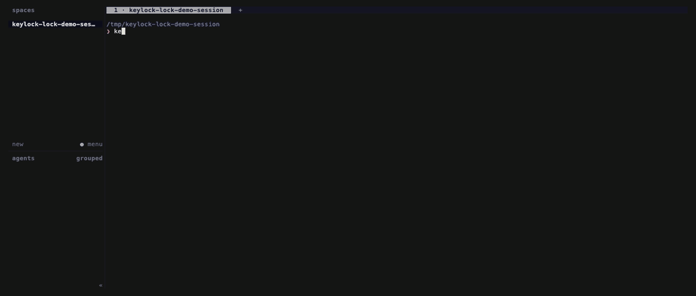
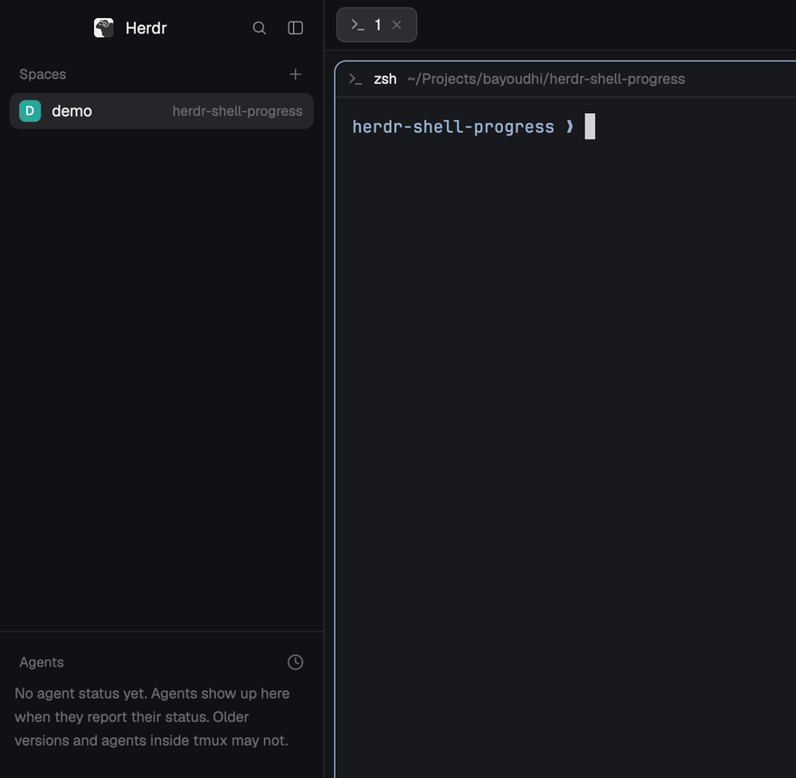

# herdr-shell-progress

Herdr shows live progress for recognized coding agents. A pane running
`cargo build --release` for four minutes shows nothing at all.

This plugin fixes that: slow shell commands report `working` with a ticking
elapsed label, and leave a result behind when they finish. It works in both
the Herdr TUI and the [Herdr desktop app](#herdr-desktop-app), with the same
shell setup.



*In the Herdr TUI: `ls` leaves no trace; `sleep 6` crosses the threshold and
appears in the sidebar as `sleep 6 · running 4s`, then settles into
`sleep 6 · ok · 6s`. [The desktop app](#herdr-desktop-app) shows it in its
Agents list.*

- Works in the Herdr TUI and the Herdr desktop app. The rc snippet picks the
  right one for each terminal; see [Herdr desktop app](#herdr-desktop-app) for
  what differs there.
- Fast commands are invisible — nothing flickers when you run `ls`.
- Failures stick until your next command, so you see what broke while away.
- Successes clear themselves after 20 seconds by default.
- A [keylock](https://github.com/bayoudhi/keylock) session that is locked
  wears a 🔒 while it runs, so you can see the pane is protected.
- Zero socket traffic and zero output for commands under the threshold — with
  one exception: the first command after a sticky failure label spends two
  requests wiping it, however fast that command is.

## keylock sessions

[keylock](https://github.com/bayoudhi/keylock) runs a command behind an input
lock: while the session is locked it drops every key, so a stray Space or
Ctrl+C cannot interrupt a long migration. Nothing in Herdr's own chrome shows
that a pane is locked. This plugin already owns that sidebar row, so it shows
it here.

While a tracked command is `keylock` and its session is locked, the row wears
the lock:

```
🔒 keylock run -- ./migrate.sh · running 4m12s
```



*The caption at the bottom names each key as it is pressed, and whether it got
through. The job aborts on any keypress, so the counter running on is the
proof: while the session is locked every key — `a`, Space, even Ctrl+C — is
dropped, and the row wears 🔒. The phrase's own letters are dropped like any
other key too, right up to the one that completes it; the lock leaves the row
within a tick, and the next key then reaches the job, which aborts as it would
have all along.*

The check runs once per tick, only for `keylock` commands, and asks keylock
itself (`keylock status --pane`) rather than guessing from the command line.
It needs keylock 0.2.0 or newer. Configure or disable it with `[lock]` in
`config.toml`; an empty `prefix` turns off both the marker and the check.
Point `HSP_KEYLOCK_BIN` at a different binary to override which `keylock` the
probe runs — mainly useful for debugging.

## Requirements

- Herdr >= 0.7.0, or the Herdr desktop app (tested with 0.1.11)
- **zsh, bash >= 3.2, or fish >= 3.1** — each has its own hook file under
  `shell/`. Any other shell needs a port; see
  [Porting to another shell](#porting-to-another-shell).
- **A Rust toolchain** — installation compiles the watcher from source. There
  are no prebuilt binaries.
- macOS or Linux. Developed and tested on macOS; the Rust and shell sides are
  all portable and Linux should work, but it has not been run there. Reports
  welcome.

## Install

How you install depends on which Herdr you run:

- **Herdr TUI**, with or without the desktop app: `herdr plugin install`,
  below.
- **The desktop app only**: [build from a clone](#desktop-app-only). The app
  has no plugin manager — it is extended with mods, not plugins — and this
  plugin does not need one there. In the app it is just the shell hook and the
  watcher binary.

Either way, the hook in your rc file serves the TUI and the app alike.

```bash
herdr plugin install bayoudhi/herdr-shell-progress
```

That runs `cargo build --release` for you.

Now add the hook to your shell's rc file. herdr checks every install out into
a fresh directory, and where depends on its version:

- herdr 0.9.5 and later:
  `~/.config/herdr/plugins/github-installations/bayoudhi.shell-progress-<hash>/<generation>/checkout`
- older herdr: `~/.config/herdr/plugins/github/bayoudhi.shell-progress-<hash>`

So each snippet finds the plugin with a glob instead of hardcoding a path that
changes on every update. It looks in the newer location first, so a copy an
older herdr left behind never wins, and takes the newest build there. If the
plugin isn't installed, it does nothing.

**zsh** — append to `~/.zshrc`:

```zsh
# herdr-shell-progress
() {
  local f=(~/.config/herdr/plugins/github-installations/bayoudhi.shell-progress-*/*/checkout/shell/init.zsh(Nom)
           ~/.config/herdr/plugins/github/bayoudhi.shell-progress-*/shell/init.zsh(Nom))
  (( $#f )) && source $f[1]
}
```

This uses zsh glob qualifiers rather than a subshell, so it costs no fork: `N`
makes a missing match empty instead of an error, and `om` orders newest-first.

**bash** — append to `~/.bashrc`:

```bash
# herdr-shell-progress
_hsp_dir=$(ls -td ~/.config/herdr/plugins/github-installations/bayoudhi.shell-progress-*/*/checkout/ 2>/dev/null | head -1)
[ -r "$_hsp_dir/shell/init.bash" ] ||
  _hsp_dir=$(ls -td ~/.config/herdr/plugins/github/bayoudhi.shell-progress-*/ 2>/dev/null | head -1)
[ -r "$_hsp_dir/shell/init.bash" ] && . "$_hsp_dir/shell/init.bash"
unset _hsp_dir
```

**fish** — append to `~/.config/fish/config.fish`:

```fish
# herdr-shell-progress
set -l _hsp_dirs ~/.config/herdr/plugins/github-installations/bayoudhi.shell-progress-*/*/checkout
set -q _hsp_dirs[1]; or set _hsp_dirs ~/.config/herdr/plugins/github/bayoudhi.shell-progress-*
if set -q _hsp_dirs[1]
    set _hsp_dirs (ls -td $_hsp_dirs)
    test -r "$_hsp_dirs[1]/shell/init.fish"; and source "$_hsp_dirs[1]/shell/init.fish"
end
```

The globs go through `set` because there a pattern may match nothing. Handed to
`ls` directly, a pattern with no match makes fish print an error at every shell
start.

Then open a **new** pane — an rc file only runs for new shells — and run
`sleep 5`.

**That block is required.** Installing the plugin alone does nothing: Herdr can
run a plugin's own processes, but only your shell knows when a command starts
and stops, so the hooks have to live in your shell.

### bash and bash-preexec

If something already loaded [bash-preexec] — Atuin and iTerm2's shell
integration both do — the hook registers with it rather than installing a
second `DEBUG` trap, which would start two watchers per command. Nothing is
needed from you beyond loading bash-preexec before this snippet.

If some *other* `DEBUG` trap is installed and bash-preexec is not there to
share it, the hook stays inert rather than breaking whatever owns the trap.
Loading bash-preexec first makes both work.

One consequence of going through bash-preexec: it hands over the command line
but not its alias-expanded form, so an aliased command reaches the ignore list
under the alias rather than the program behind it. See
[Ignoring commands](#ignoring-commands).

[bash-preexec]: https://github.com/rcaloras/bash-preexec

<details>
<summary>Installed from a clone, or want to check the path by hand?</summary>

For a `plugin link` install, source your clone directly:

```zsh
source ~/herdr-shell-progress/shell/init.zsh   # or init.bash, or init.fish
```

To see the resolved path for an installed copy:

```bash
herdr plugin list --json \
  | python3 -c 'import json,sys;print(next(p["plugin_root"] for p in json.load(sys.stdin)["result"]["plugins"] if p["plugin_id"]=="bayoudhi.shell-progress"))'
```

There is also a `print-snippet` action. It prints the block above for your
`$SHELL`, or a plain `source` line for a linked clone. Note that
`herdr plugin action invoke` returns an invocation record on stdout and sends
the action's own output to the plugin log — so you would need
`herdr plugin log list --plugin bayoudhi.shell-progress` to read it. Copying the
block from here avoids that entirely.

</details>

### From a clone instead

```bash
git clone https://github.com/bayoudhi/herdr-shell-progress ~/herdr-shell-progress
cd ~/herdr-shell-progress
cargo build --release
herdr plugin link ~/herdr-shell-progress
echo 'source ~/herdr-shell-progress/shell/init.zsh' >> ~/.zshrc  # init.bash / init.fish
```

`herdr plugin link` deliberately does *not* run build commands, so the
`cargo build` is required here.

### Desktop app only

Without the Herdr TUI there is no `herdr` CLI, so there is no
`herdr plugin install` to run. Build a clone and source the hook from it:

```bash
git clone https://github.com/bayoudhi/herdr-shell-progress ~/herdr-shell-progress
cd ~/herdr-shell-progress
cargo build --release
echo 'source ~/herdr-shell-progress/shell/init.zsh' >> ~/.zshrc  # init.bash / init.fish
```

Then open a **new** terminal in the app and run `sleep 5`: the terminal shows
up under **Working** in the Agents list. To update, `git pull` and run
`cargo build --release` again.

## Configure

```bash
herdr plugin config-dir bayoudhi.shell-progress
```

Without the `herdr` CLI, the directory is
`~/.config/herdr/plugins/config/bayoudhi.shell-progress`.

Copy `config.example.toml` into that directory as `config.toml`. Every key is
optional. Changes take effect on your next command — no reload, no restart.

### Ignoring commands

Some commands should never be reported: interactive programs that legitimately
run for hours, and above all coding-agent CLIs. If this plugin reports on a pane
running an agent, it and Herdr's own integration both try to own that pane's
state, and yours wins — hiding what the pane actually is.

Two keys control this, and the difference matters:

```toml
# ADDS to the defaults. This is almost certainly the one you want.
ignore_extra = ["claude-personal", "terraform", "docker"]

# REPLACES the defaults entirely. Setting this drops every built-in entry,
# including the agent CLIs, unless you list them again yourself.
# ignore = ["vim", "less"]
```

Matching is on the **basename of the program name**, exactly. The command is
read after alias expansion, and leading `VAR=value` assignments plus the
transparent wrappers `command`, `builtin`, `exec`, `env` and `nohup` are looked
through. So an alias like

```zsh
alias claude-personal='CLAUDE_CONFIG_DIR=~/.claude-personal command claude'
```

matches the built-in `claude` entry without any configuration.

zsh gets the expanded form from `preexec` and bash from `$BASH_COMMAND`. fish
needs no expansion — its abbreviations are already expanded in the submitted
line, and its functions carry the name you would think to ignore.

The exception is bash going through [bash-preexec], which hands over the command
line but not its expanded form. There, an alias reaches the ignore list under
its own name, so list the alias as well:

```toml
ignore_extra = ["claude-personal"]
```

A **wrapper script** is different: it is a real program, and the agent it runs
is invisible from the outside, so it needs its own entry. Same for a renamed
build. If a pane shows a long "running" label for something that isn't really a
shell command — or the pane's own agent looks like it has been taken over —
this is why:

```bash
printf 'ignore_extra = ["my-wrapper"]\n' \
  >> "$(herdr plugin config-dir bayoudhi.shell-progress)/config.toml"
```

It applies on your next command — no reload, no restart.

Defaults: `vim`, `nvim`, `less`, `man`, `ssh`, `top`, `htop`, `zsh`, `bash`,
`sh`, `fish`, `claude`, `codex`, `opencode`, `droid`.

## Where shell commands show up

They appear in the sidebar's **agents** list, alongside your coding agents.
That is simply where Herdr shows pane status; a plugin cannot add a section of
its own, and there is no setting to filter or separate them.

What the plugin does do is report a **constant agent id**, `shell`, for every
command. Without that, each distinct command would mint its own agent identity
and your list would fill up with `cargo`, `sleep`, `make`, and every other
binary you ever ran. One id keeps it to a single kind of entry. The row still
shows the actual command — the line as you typed it, so `npm run start` rather
than a bare `npm` — sent as `display_agent`, which Herdr renders in preference
to the id.

Row names are cut at `max_display_len` (24 characters by default) with an `…`
marking the cut, and runs of whitespace are collapsed so the row stays tight.
Raise or lower it in `config.toml`:

```toml
max_display_len = 32
```

Keep it under Herdr's own `ui.sidebar_max_width`, which defaults to 36 columns.
The row spends columns on the state icon and the elapsed label too, so a wider
cap does not widen the name — Herdr truncates it again, and the elapsed label is
what gets squeezed out.

The ignore list is unaffected by any of this: it still matches on the program
name alone, as does the `{agent}` label variable.

**These entries cannot be restyled.** Herdr's `rows_by_agent` table is validated
against its own canonical agent ids (`claude`, `codex`, `gemini`, and so on) and
rejects anything else. It rejects it by refusing to parse the entire config
file, so adding a rule for this plugin does not merely fail to apply — Herdr
silently falls back to default settings and you lose your keybindings and theme
until you remove it. An earlier version of this README recommended exactly that;
if you followed it, delete the rule and run `herdr config check`.

If you would rather a command never appear at all, that is what
[`ignore_extra`](#ignoring-commands) is for.

### Showing the elapsed label

Herdr's default sidebar rows are:

```toml
rows = [["state_icon", "workspace", "tab"], ["agent"]]
```

There is no `state_text` in there, so out of the box you get the spinner and the
command line but **not** the `running 4s` label — the plugin reports it, and
nothing displays it. To see what the demo above shows, add `state_text` to the
second row in your Herdr `config.toml`:

```toml
[ui.sidebar.agents]
rows = [["state_icon", "workspace", "tab"], ["agent", "state_text"]]
```

Then `herdr config check` and `herdr server reload-config`. This is the plain
`rows` key, which accepts any of Herdr's built-in row fields — unlike
`rows_by_agent` above, it is not restricted to canonical agent ids.

This also affects the finish labels: `ok · 4s`, `exit 1 · 12s`, and `SIGINT · 3s`
all live in `state_text`.

## Herdr desktop app

The desktop app runs its terminals in herdr-core instead of the Herdr server,
and herdr-core has no socket method for reporting a pane's state. A program
reports by printing an [OSC 7501][psp] escape sequence into its own terminal,
which is how Claude Code shows up in the app's agent list. The hooks speak that
protocol when they find themselves in an app terminal, so nothing changes in
your rc file: the snippet from [Install](#install) works in both.

The hooks tell the two apart by environment. Herdr panes have `HERDR_PANE_ID`;
desktop-app terminals have `HC_TERMINAL_ID`. When both are set — a Herdr pane
running inside an app terminal — the pane wins, since that is where the command
runs.

In the app, a slow command makes its terminal an agent:



*`ls shell` leaves no trace; `sleep 6` crosses the threshold, shows up under
**Working** in the Agents list as `demo · sleep 6`, and lands under **Done**
when it finishes.*

| What happened | State | Message |
|---|---|---|
| running past the threshold | `working` | the command line |
| finished with exit 0 | `done` | `ok · 4m12s` |
| failed | `error` | `exit 1 · 12s` |
| Ctrl+C, or a signal | `idle` | `SIGINT · 3s` |

A row in the Agents list reads `<space> · <title>`, and the title is the
terminal's own, which your shell sets. oh-my-zsh, for one, sets it to the
command line while it runs, so the row reads `api · cargo build`; a shell that
never sets one shows the terminal's address (`t1`) there instead.

The report's `app` is the program name (`cargo`, `npm`), so the app draws that
program's icon. The message is in the report too — `hc get <terminal>` prints
it, and mods can read it — but the app's own agent list shows only the state and
how long the terminal has been in it.

Some things work differently:

- **No ticking label.** The app already shows how long an agent has been in its
  state, and every report written into a busy terminal is a chance of landing
  in the middle of the program's own output. So the watcher writes exactly one
  report, at the threshold, and nothing more while the command runs.
- **Results stay until your next command.** The protocol has no expiry, so
  `success_sticky_ms` cannot be a duration here. `done` turns into `idle` once
  you look at the terminal, and your next command clears it either way.
  `success_sticky_ms = 0` still clears a success the moment it finishes, and
  `failure_sticky = false` reports a failure as `idle` instead of `error`.
- **No keylock 🔒.** Keeping the lock up to date needs a report every tick.
- **[Showing the elapsed label](#showing-the-elapsed-label) does not apply.**
  `[ui.sidebar.agents]` configures the Herdr TUI, not the app.

The config file lives where it does for the Herdr TUI:
`~/.config/herdr/plugins/config/bayoudhi.shell-progress/config.toml`. To install
without the Herdr TUI, see [Desktop app only](#desktop-app-only).

[psp]: https://superlogical.com/rex/docs/build/program-status

## How it works

The pre-command hook spawns a detached watcher. The watcher sleeps until the
threshold; if the command finishes first it exits having never touched the
socket. Otherwise it reports via `pane.report_agent` and ticks
`pane.report_metadata`. The pre-prompt hook writes the exit code and signals the
watcher, which posts the final label and exits.

Under zsh that costs one fork per prompt — the watcher itself — because
everything else is a builtin. bash pays a second fork to read `history 1`, and
fish a second fork for `kill`, which it has no builtin for.

The watcher writes nothing to stdout or stderr — it inherits the pane's tty, so
any output would corrupt your shell session.

In the desktop app, the watcher reports by opening `/dev/tty` and writing one
OSC 7501 sequence when the command crosses the threshold. The final report is
not the watcher's: the pre-prompt hook runs `herdr-shell-progress finish`
in the foreground, after the command has ended and before the prompt is drawn,
when nothing else is writing to the terminal. The pre-command hook clears the
previous command's record the same way, with a `printf`. A command that never
crosses the threshold writes nothing and costs no extra fork. `src/osc_watch.rs`
explains how the watcher and `finish` stay in order when the command ends just
as the watcher decides to report it.

## Porting to another shell

The Rust watcher is shell-agnostic. Everything shell-specific lives in
`shell/init.zsh`, `shell/init.bash` and `shell/init.fish`, each about 50 to 100
lines, and a port needs to do three things:

1. On command start: write the command line to `<state-dir>/cmd`, then spawn
   `herdr-shell-progress watch --pane "$HERDR_PANE_ID" --shell-pid <shell pid>
   --start-ms <epoch ms> --state-dir <state-dir>`, detached, with both streams
   redirected to `/dev/null`. Pass `--clear-first` if `<state-dir>/marker`
   exists. A shell with no cheap millisecond clock can pass `--start-now`
   instead of `--start-ms` and let the watcher read its own.
2. On command end: write `$?` to `<state-dir>/exit`, then send `SIGUSR1` to the
   watcher.
3. On shell exit: send `SIGTERM` to the watcher.

For the desktop app, used when `HC_TERMINAL_ID` is set and `HERDR_PANE_ID` is
not, a port changes those steps:

1. Pass `--pane "$HC_TERMINAL_ID" --osc` to `watch`, and use its own state
   directory (the hooks use `hc-<terminal id>`). Before spawning it, if
   `<state-dir>/osc-shown` is non-empty, print `ESC ] 7501 ; state=clear ESC \`
   to `/dev/tty` and empty the file. Then empty `<state-dir>/exit` and
   `<state-dir>/osc-start`.
2. After signalling the watcher, and only then, check `<state-dir>/osc-start`.
   If it is non-empty, run `herdr-shell-progress finish --state-dir <state-dir>
   --exit <status>` in the foreground, with both streams redirected to
   `/dev/null`.

There is one optional fourth: a shell whose pre-command hook cannot see both the
whole command line and its alias-expanded form — bash is the only one so far —
can write the expanded leading command to `<state-dir>/name`, and the watcher
will match the ignore list against that instead of against `cmd`. The file is
consumed on read.

New hooks belong in `tests/hooks.rs`, which drives each one through a real
interactive shell on a pty and checks what it spawned. PRs welcome.

## Uninstall

```bash
herdr plugin uninstall bayoudhi.shell-progress
```

Use `herdr plugin unlink bayoudhi.shell-progress` instead if you installed from
a clone with `plugin link`. For a [desktop-app-only](#desktop-app-only)
install, delete the clone.

Then remove the block from your shell's rc file. It is what actually runs the
plugin, so leaving it behind after uninstalling leaves a dangling `source` that
your shell will complain about on every new pane.
